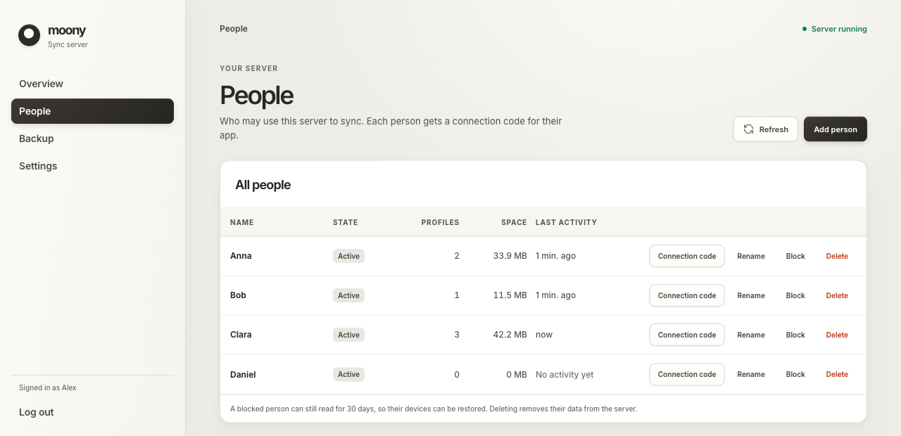
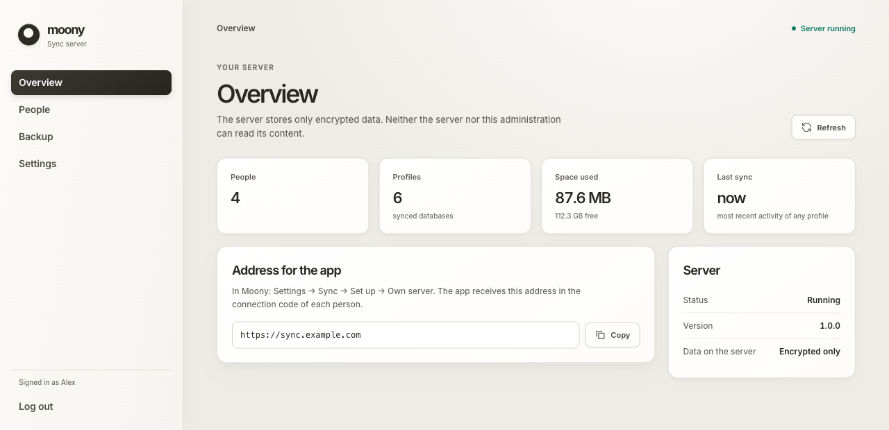

# Moony sync server

[](https://github.com/fiiles/moony-sync/actions/workflows/ci.yml)
[](./LICENSE)

A small server you run yourself, so your [Moony](https://github.com/fiiles/Moony) devices can
keep their data in sync without any cloud service in between. It stores and forwards
**encrypted** change records, encrypted snapshots, and the apps' encrypted documents and photos.
It cannot read them: the keys never leave your devices.

- One Node process, one folder of data (a SQLite database, snapshot files and the files of
  documents and photos).
- A web page to add the people who may use it, block them, delete them and download a backup.
- No outbound connections. No e-mail, no analytics, no telemetry.
- Written for a home server or a NAS: a Docker container, `compose.yml`, and a few lines of reverse
  proxy configuration for https.

<p align="center"></p>
<p align="center"></p>

The screenshots show made-up people and random data.

How the protocol works, what the server stores and what it can see: [`DESIGN.md`](DESIGN.md).

## Run it

You need Docker with the compose plugin. This repository does not publish an image; you build it
once from the source:

```bash
git clone https://github.com/fiiles/moony-sync.git
cd moony-sync
mkdir data && chown 1000:1000 data     # the container runs as user "node" (uid 1000)
docker compose up -d --build
docker compose logs moony-sync         # shows the one-time setup code
```

`compose.yml` builds the image as `moony-sync:local`, publishes port 8787 and keeps all state in
`./data`. The container restarts by itself (`restart: unless-stopped`) and has a health check on
`GET /health`.

The `chown` matters with a bind mount: Docker creates a missing `./data` as root, and the server
could not write to it. If you prefer a named volume, replace `./data:/data` with a volume name.

Without Docker (Node 22 or newer):

```bash
npm ci && npm run build
DATA_DIR=./data PORT=8787 node dist/main.js
```

## First setup

1. Open `http://<server>:8787` in a browser. Until an admin exists the page shows only the setup
   form.
2. Enter the **setup code** from the log (`docker compose logs moony-sync`; the line starts with
   `Setup code:`), a name for the admin and a password of at least 10 characters. While there is
   no admin the server prints a new random code at every start, so always read the latest line.
   A code written by `reset-admin` is the exception: it stays valid across restarts until used.
3. If a reverse proxy stands in front (see [https](#https-behind-a-reverse-proxy)), publish the
   port to the proxy only (`127.0.0.1:8787:8787` in `compose.yml`) and set `TRUST_PROXY=1`. The
   overview shows a warning when the server sees either half of this done wrong.
4. The overview asks you to confirm the **address apps use** before you can add anyone. It is
   pre-filled with the address your browser is using right now, which is only right if the apps
   will reach the server the same way (see [https](#https-behind-a-reverse-proxy)). Confirm it or
   type the real one, for example `https://sync.example.com`. Set `PUBLIC_URL` to have it ready,
   and change it later under Settings.
5. Optional but sensible: Settings, turn on the second factor (an authenticator app). It gives
   you ten one-time backup codes, shown once.

The admin is one account. There are no other admins and no e-mail: a forgotten password is fixed
with [reset-admin](#lost-admin-password-reset-admin).

## Add a person

Every person who syncs through your server is added by you.

1. People, **Add person**. Type a name. The name is only for you; it is shown on this page and
   stored on the server, never sent to the apps.
2. The page shows a **connection code**: text starting with `moony-sync1:` and a QR code. It holds
   the server address and the person's account number.
3. In Moony, on the device that has the data: Settings, Sync, Set up, Own server, and paste the
   code (or scan the QR code with the phone). The next devices are added in Moony itself, with its
   pairing.

The connection code is a **credential**: whoever has it can use that person's account on this
server (create up to 5 profiles, fill their space). It cannot read any existing profile, and
nothing can be decrypted with it. Send it only to that person. Show it again later with
People, the person, **Connection code**; that asks for your password first.

Other things you can do per person: rename, **block** (the person's devices stop writing at once
and can still read for 30 days; nothing is deleted; unblocking lets them continue), **delete**
(removes the person and all their data on the server; their devices will report that the synced
data were deleted), and delete a single profile from the person's detail page.

Each profile may store 10 GiB of documents and photos by default. Settings, **Space for documents
and photos**, changes the limit for the whole server; a lower limit keeps the files already stored
and makes new ones wait until there is room.

## https behind a reverse proxy

Moony accepts plain `http://` for your own server but warns about it (see below). For anything
that leaves your home network, or for the comfort of a padlock, put a reverse proxy with https in
front. Set **`TRUST_PROXY=1`** in the container's environment when you do:

```yaml
    environment:
      TRUST_PROXY: "1"
      PUBLIC_URL: "https://sync.example.com"
```

What `TRUST_PROXY=1` does:

- The server takes the client address for its rate limits, and the scheme and host for the admin
  page, from the **last** entry of `X-Forwarded-For`, `X-Forwarded-Host` and `X-Forwarded-Proto`.
  That is the entry your proxy appended itself. It means **exactly one reverse proxy directly in
  front of the server**. If a CDN or another proxy sits in front of your proxy, the server sees
  the first proxy's address for every visitor, and all clients share one rate-limit key.
- Behind an https proxy it makes the admin's session cookie `Secure`. Without it the server thinks
  the connection is plain http and does not set that flag.
- Do not set it when clients reach the server directly: anyone could then choose their own
  address by sending the header. Publish the port to the proxy only for the same reason.
- The overview warns about both mistakes, from request headers alone (nothing is stored or
  logged about the client): forwarding headers arriving while `TRUST_PROXY` is off, and a request
  without them while it is on. The server also logs each warning once. With `TRUST_PROXY` on, a
  monitor or `curl` that reaches the published port directly raises the second warning; only
  `/health` is exempt. A warning stays until the server is restarted (it never clears by
  itself), so after you have fixed the port binding or the setting, restart the server and the
  banner goes away. The first warning is a hint, not proof: any client can send a forwarding
  header while `TRUST_PROXY` is off.

### Caddy

Caddy gets and renews the certificate on its own. With Caddy on the same machine:

```
sync.example.com {
	reverse_proxy 127.0.0.1:8787
}
```

In `compose.yml`, publish the port on the loopback address only, so nothing but Caddy can reach it
(use the commented line there instead of `"8787:8787"`):

```yaml
    ports:
      - "127.0.0.1:8787:8787"
```

If Caddy runs in the same compose project, use `reverse_proxy moony-sync:8787`. Caddy has no upload
size limit by default.

### Nginx Proxy Manager

Add a Proxy Host: domain `sync.example.com`, scheme `http`, the host name or address of the
server, port `8787`. On the SSL tab request a Let's Encrypt certificate and turn on Force SSL.

**Raise the upload limit.** Nginx's default of 1 MB would refuse every snapshot upload (they can
be up to 100 MiB). Under *Advanced*, add:

```
client_max_body_size 128m;
proxy_read_timeout 900s;
proxy_send_timeout 900s;
```

The same applies to any nginx you configure by hand.

### Plain http

Plain `http://` works, and for a server that is only on your own network it is a choice many
people make. It exposes, to anyone who can watch the network between the device and the server:

- the admin password, the session cookie and the second-factor codes, when you use the admin page,
- the connection codes shown on the page,
- people's account numbers and vault tokens (these let someone read the stored encrypted data,
  and write to it), and Recovery Kit tokens when a Kit is used (they read the Kit's encrypted copy
  of the keys, which is useless without the printed Kit).

It does not expose your finances: the apps encrypt everything before it leaves the device, and
the server never sees a key. The admin page tells you when it is opened over plain http from a
host other than `localhost`.

## Backup and restore

Admin page, **Backup**, **Download backup**: a `.tar` with a consistent copy of the database,
all snapshot files and all documents and photos. It can be taken while the server runs. With
documents and photos it can be large, so the page shows an estimate of its size first.

**Keep the archive private.** Besides the encrypted data it holds each person's account number
(needed to show a connection code again) and the second-factor secret in readable form, plus
names and password hashes.

To restore:

```bash
docker compose down
# empty ./data, then unpack the archive into it
tar -xf moony-sync-backup-YYYYMMDD-HHmm.tar -C data
chown -R 1000:1000 data     # safety line; the archive already says uid/gid 1000
docker compose up -d
```

Make sure no old `moony-sync.db-wal` or `moony-sync.db-shm` stays next to the restored database.

**The consequence of restoring an old backup.** The server then holds an older state than your
devices. Moony notices this and reports that the **sync server went back**. The way out is to set
sync up again from the device with the most complete data. A backup protects you against losing
the server, not against losing devices; the Recovery Kit is still what you need for that.

You can also copy the whole `./data` folder while the container is stopped. There is no automatic
backup schedule.

## Update

You build the image yourself, so an update is:

```bash
git pull
docker compose up -d --build
```

The server migrates its database at start with append-only numbered migrations. It refuses to
start on a database written by a newer version, so going back to an older version needs a
restored backup. Take a backup first.

## Lost admin password (reset-admin)

```bash
docker compose exec moony-sync moony-sync reset-admin
# or: docker exec <container> moony-sync reset-admin
```

This deletes the admin, its second factor and all sessions, and prints a new setup code. Open the
admin page, enter that code and create the admin again. People, their accounts and all data are
untouched, and a running server picks the new code up without a restart. Whoever can run commands
in the container can do this; that is the intended recovery, and the server never sends e-mail.

Login, setup code and second-factor attempts are limited per client address and across all
clients. These counters are **in memory**: a lockout lasts up to 15 minutes or until the server
restarts, whichever comes first, unless you clear it:

```bash
docker compose exec moony-sync moony-sync unlock-admin
# prints: Login attempts were reset.
```

`unlock-admin` clears the login, setup code and second-factor counters of a running server (it
does not touch the admin, sessions or data); `reset-admin` clears them too. A password check by an
admin who is already signed in (change password, second factor, connection code) is counted
against that client address only, so strangers' failed logins never refuse it.

Behind a reverse proxy without `TRUST_PROXY=1` all clients share one address, so five wrong logins
from anyone lock the login for 15 minutes for everybody; `unlock-admin` clears that too.

## If the server refuses to start

Two vault IDs in the database that differ only by letter case (a database from before IDs were
unique ignoring case) stop the server with one line. Stop the container, back up the data folder,
then open the database with `sqlite3 <data folder>/moony-sync.db` and run:

```sql
SELECT vault_id, head, last_activity FROM vaults WHERE lower(vault_id) IN
  (SELECT lower(vault_id) FROM vaults GROUP BY 1 HAVING COUNT(*) > 1) ORDER BY lower(vault_id);
PRAGMA foreign_keys=ON;
DELETE FROM vaults WHERE vault_id = '<the spelling to remove>';
```

`PRAGMA foreign_keys=ON` must come first: the `sqlite3` tool starts with it off, and without it the
vault's ops, key changes and snapshot and blob records stay behind. Its snapshot and blob files are
removed by the server's next clean-up, once they are an hour old. Then start the server.

Delete the spelling the person's devices do not use. A device shows its vault ID only inside the
app, so in practice delete the one with the older `last_activity` (a unix time; `NULL` means it
never had any) or the lower `head` (the number of ops it has received; `0` means none).

## Settings (environment variables)

All optional. Everything else is set on the admin page and stored in the database.

| Variable | Default | Meaning |
|---|---|---|
| `PORT` | `8787` | Listening port |
| `DATA_DIR` | `/data` (in the image) | Database, snapshots and blobs |
| `PUBLIC_URL` | unset | The address apps use, for connection codes. The address saved on the admin's Settings page wins over it. |
| `TRUST_PROXY` | `0` | `1` behind one reverse proxy, see above. Accepts `1`, `0`, `true`, `false` in any case; anything else stops the server at start. |
| `REQUIRE_2FA` | `0` | `1` makes the admin's second factor mandatory: enrolment is forced after login and cannot be turned off. Same accepted values. |
| `SETUP_CODE` | random at every start | A fixed setup code for automated installs. Ignored once an admin exists. |

## What it stores

In `DATA_DIR`: `moony-sync.db` (SQLite, WAL mode, with `-wal` and `-shm` files next to it), a
`snapshots/` folder and a `blobs/` folder. Snapshots, documents and photos are encrypted by the
apps; the server keeps the newest two snapshots per profile. Housekeeping runs once a day inside
the server (it also cleans up abandoned document uploads), and every time rule is also checked on
each request, so a stopped server misses nothing. Uploads stop with "server full" (`507`) when
less than 1 GiB would remain free on the data volume (uploads still running count as used), and
ordinary sync goes on. Details in [`DESIGN.md`](DESIGN.md).

The log (stdout) contains the start-up line, the setup code while there is no admin,
`housekeeping: <step> failed`, `unhandled error: <error name>` (the name only) and
`shutdown: WAL checkpoint failed`. The HTTP layer may also print a stack trace when a file stream
fails; it contains no paths or IDs. A start that is refused (a bad setting, or a database from a
newer server) prints one line to stderr and exits with status 1. The log never contains account
numbers, tokens, profile or mailbox IDs, file paths or client addresses.

Pairing mailboxes hold their contents for at most about 11 minutes (10-minute expiry plus a sweep
that runs every minute); after that only a content-free tombstone remains. Limits that answer
`503 {"error":"busy"}`: all open pairing slots together hold at most 64 MiB (one client address,
or IPv6 /64, at most 8 MiB of that), and request bodies being buffered at one moment (sync and
admin API together; snapshot uploads stream to disk and do not count) share 64 MiB (one client
address, or IPv6 /64, at most 8 MiB of it), reserved as the bytes arrive. A body that delivers
nothing for 30 seconds is aborted with `408 {"error":"body_timeout"}`; this includes snapshot
and document uploads. With `TRUST_PROXY=1` the
**last** `X-Forwarded-For` entry is the client address.

## Known limits

- **Anyone can lock the login.** On a home network anyone who can reach the server can keep the
  admin login refused (50 wrong attempts per 15 minutes) until the operator runs
  `moony-sync unlock-admin`. Behind a reverse proxy without `TRUST_PROXY=1` all clients share one
  address, so five wrong logins from anyone lock the login for 15 minutes; `unlock-admin` clears
  that too.
- **No Host allowlist.** A web page that rebinds its DNS name to your server's LAN address can
  reach the **unauthenticated** routes of a LAN-only server through a visitor's browser. Neither
  https nor keeping the address secret prevents that. What protects the server is that setup
  needs the code from the log, login is attempt-limited, and everything else needs a session or
  a vault token.
- **Quota and parallel uploads.** A person's op quota is 256 MiB, counted as the ciphertext plus
  128 bytes per change (so many tiny changes cannot use up the disk unnoticed); real disk use is
  still higher because of row and index overhead beyond the 128 bytes charged: for very small
  changes the real disk cost can be up to about twice the quota. Snapshot uploads (100 MiB each,
  2 kept per profile) are not limited in parallel, but a profile may upload at most two documents
  or photos at once (the nginx `client_max_body_size 128m` advice already covers a 100 MiB
  document).

## Development

```bash
npm ci
npm test            # Vitest: the server called in-process, plus the admin interface (jsdom)
npm run typecheck   # server and admin interface
npm run build       # admin interface (admin-ui/dist) and server (dist/)
npm start           # node dist/main.js
npm run dev:ui      # Vite dev server for the admin interface
```

```
src/              the server: sync API (sync-api.ts), vaults, mailboxes, people, admin/
admin-ui/         the admin web interface (Preact, built with Vite, served by the server)
test/             server tests, each on a temporary data directory and a clock the test moves
Dockerfile        multi-stage build on node:24-bookworm-slim
compose.yml       the service as described above
DESIGN.md         protocol, storage, admin, what the server knows
```

How to contribute, and the checks a change must pass: [CONTRIBUTING.md](CONTRIBUTING.md).

## Built with AI assistance

Like Moony, this server is developed by one maintainer working with AI coding agents. They
follow written rules ([AGENTS.md](AGENTS.md)), and every change must pass the type check and the
tests, which CI runs again. That reduces mistakes but does not remove them; please report what
you find.

## Help and security

- **Bugs, ideas and questions:**
  [open an issue](https://github.com/fiiles/moony-sync/issues/new/choose). Never paste a
  connection code, an account number, a token, a setup code or a backup archive.
- **Security problems:** follow [SECURITY.md](SECURITY.md); do not file a public issue.

## License

Copyright © 2026 Filip Král

The Moony sync server is free software: you can redistribute it and/or modify it under the terms
of the **GNU Affero General Public License v3.0** as published by the Free Software Foundation.
If you run a modified version for other people, the license asks you to offer them its source.
The full text is in [LICENSE](LICENSE). The software comes with no warranty.
